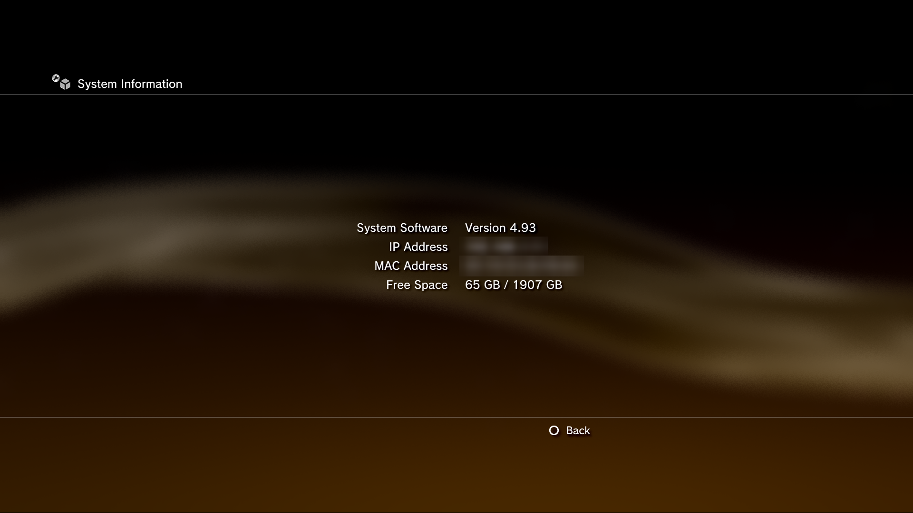

# ps3cfw: a 2 TB internal SSD on a launch PS3 (CECHA00)

Firmware patches that let a CECHA00 (the launch 60 GB "fat" PS3 with NAND flash) running
**Evilnat 4.93 Cobra 8.5 CEX** custom firmware format, use and **repair** a 2 TB SATA SSD as
its internal drive.

Stock firmware has two limits that stop this:

* It refuses drives larger than 1536 GiB (about 1.65 TB).
* Its full file-system checker (Recovery Mode "Restore File System" and the automatic check
  after a power cut) gets 32 MiB of memory. A 2 TB volume needs 58-62 MiB for its block
  bitmap alone, so a repair would fail.

The patch set **HDD2TB-P13** changes four firmware modules to fix both.

**Download:** the latest release
([26.10.29](https://github.com/Buyukcaglar/ps3cfw/releases/latest)) has the HDD2TB-P13
`PS3UPDAT.PUP` (215,765,852 bytes, SHA-256 `652c0c03...6d`) and its
[release notes](docs/releases/26.10.29.md).

**To use it, read the [user guide](docs/USER-GUIDE.md).** It covers requirements, Recovery
Mode, installing, fitting a new drive, maintenance, performance, rollback and brick recovery.

> **Warning.** This modifies CORE_OS and VSH modules. A bad install can brick the console,
> and only a hardware NAND flasher plus a NAND backup of that console can recover it.
> CECHA00 only. Never install over official or hybrid firmware, and never install an
> official Sony update afterwards.

*The CECHA00 test console's System Information with HDD2TB-P13 and a Lexar NQ100 2TB, during
the near-full repair test (65 GB free of 1907 GB). IP and MAC addresses blurred.*

## Status

**v1.0 = HDD2TB-P13**, accepted 2026-10-29 after hardware tests on a real CECHA00. It is in
daily use on a Lexar NQ100 2TB. A long-term soak with monthly repair checks runs until about
2027-01-29.

| Test on hardware (2026-10-29) | Result |
|---|---|
| Install P13 (G1) | Installed module matches the build; free space unchanged |
| Power cut, automatic repair, empty PNY 2TB (G3a) | Completed; the checker used the 128 MiB budget, peak 61.83 MiB |
| Recovery Mode repair, populated Lexar at 66 GB free (G2) | Completed in under 4 minutes, no failed allocations, 236 of 236 control reads exact |
| Power cut, automatic repair, populated Lexar (G3b) | Completed in about 3 minutes, 236 of 236 exact, Gran Turismo 6 and LittleBigPlanet 3 fine |

Earlier evidence (October 2026): native format on Crucial BX500, PNY and Lexar 2 TB drives;
file-level migration of a 1 TB drive (331,755 files, 830 GB) verified; a native fill to 66 GB
free with full readback; data above the old 1536 GiB limit verified from a PC.
Details: [docs/TECHNICAL.md](docs/TECHNICAL.md), evidence in [runs/](runs/).

## What the patch set changes

| Step | Module | Change |
|---|---|---|
| P1 | `emer_init.self` (CORE_OS) | Drive admission limit 1536 GiB -> 1984 GiB (2,130,303,778,816 B) |
| P3 | `sysconf_plugin.sprx` (VSH) | XMB admission limit raised to match |
| P4 | `lv2_kernel` (CORE_OS) | Aggregate mount ceiling 128 KiB -> 192 KiB (a 2 TB Lexar needs 144,397 B) |
| P5 | `sysconf_plugin.sprx` | Checker memory 32 MiB -> 128 MiB; rejects failed allocations before starting the checker |
| P6-P8 | `libfs_utility_init.sprx` | Heap observer: writes a 272-byte report to a USB stick after each full repair (diagnostic) |
| P9-P13 | `libfs_utility_init.sprx` | Checker error-path fixes: allocation overflow, failed seeks, missing summary buffers, read errors |

Everything else is unchanged Evilnat 4.93 Cobra 8.5 CEX. Addresses, byte patterns and the
reasoning are in [docs/TECHNICAL.md](docs/TECHNICAL.md).

| PUP | Size | SHA-256 |
|---|---|---|
| Baseline Evilnat 4.93 Cobra 8.5 CEX | 215,764,316 B | `ad1c01f8aae443643d1c4b31f164fa1bb6b65c504bab9b238065830a5e8e3f9a` |
| HDD2TB-P13 | 215,765,852 B | `652c0c0312cd51283473e653df6e2cdfd874a674f6fb7e83979c45d28fed066d` |

## Performance

* Reads: about 60 MB/s sequential and under 1 ms per small random read. The console's
  storage stack sets this limit, so a faster SSD will not load games faster.
* Writes: about 29 MB/s for the first ~25 GB after the console has been idle, then about
  12 MB/s. The slowdown is inside the SSD (write cache, and no TRIM from the PS3).

Analysis: [docs/research/PERF001/ANALYSIS-20261029.md](docs/research/PERF001/ANALYSIS-20261029.md).

## What is in this repository, and what is not

Included: documentation, the project's Python tools, the heap observer source, the native
fill/verify app source, the patch generators, build and verification manifests, and test
results.

Not included:

| Not published | Why |
|---|---|
| Other firmware binaries (baseline and intermediate PUPs, SELF/SPRX/ELF modules) | Only the finished P13 PUP is published, as a release download; the baseline is Evilnat's file. GitHub also rejects repository files over 100 MB |
| PS3 keys and the console's `eid_root_key` | Keys are not redistributed; the console key is unique to one console |
| The owner's console data (`vault/`: NAND dumps, HDD image, device captures) | Private and console-unique |
| Third-party tools (`tools/<name>/`) | Separate projects; see the table below |
| The pre-takeover history archive | Large, and not reviewed for publication |

Redacted from the published files: drive serial numbers, LAN addresses, a USB volume GUID,
the owner's name and time zone, the list of files on the owner's drive, and photos of the
owner's TV. Some historical research files record SHA-256 hashes of other files; where those
files were redacted, the recorded hashes no longer match.

## Building

The build runs on Windows with Python 3.14 and pycryptodome.

* `tools/build_hdd2tb_p13.py` builds P13 by repacking the patched `libfs_utility_init` module
  into the P12 PUP. It re-encrypts the SELF, rebuilds the flash archive and the PKG/SPKG
  headers, and regenerates the PUP HMAC.
* `tools/verify_build.py` checks that this rebuild is byte-identical to the release.

Both inputs (the P12 PUP and the patched module) are not published, so **the public
repository cannot rebuild the PUP yet**; use the release download. A patcher that applies P1-P13
to a baseline PUP you supply, checked against the SHA-256 above, is on the
[roadmap backlog](docs/ROADMAP.md).

The build scripts expect these third-party projects as clones under `tools/`. The key files
are not part of this repository:

| Folder | Project |
|---|---|
| `tools/scetool`, `tools/scetool_keys` | [naehrwert/scetool](https://github.com/naehrwert/scetool), [Sorvigolova/scetool](https://github.com/Sorvigolova/scetool) |
| `tools/mfw-builder` | [haxxxen/ps3mfw-builder-0.2.1-mod](https://github.com/haxxxen/ps3mfw-builder-0.2.1-mod) |
| `tools/ps3keys` | [codyps/ps3keys](https://github.com/codyps/ps3keys) |
| `tools/ps3tools` | [SophieGer/ps3tools](https://github.com/SophieGer/ps3tools) |
| `tools/PS3HDDTool` | [Buyukcaglar/PS3HDDTool](https://github.com/Buyukcaglar/PS3HDDTool) (fork of [Pheeeeenom/PS3HDDTool](https://github.com/Pheeeeenom/PS3HDDTool)) |
| `tools/PS3-HDD-Reader` | [jhonathanc/PS3-HDD-Reader](https://github.com/jhonathanc/PS3-HDD-Reader) |
| `tools/PS3DumpChecker` | [T0X1Cx/PS3DumpChecker](https://github.com/T0X1Cx/PS3DumpChecker) |
| `tools/cobra-source` | [xXEvilnatXx/Cobra-PS3](https://github.com/xXEvilnatXx/Cobra-PS3) |
| `tools/xai_plugin_source` | [xXEvilnatXx/xai_plugin](https://github.com/xXEvilnatXx/xai_plugin) |
| `tools/webman-source` | [aldostools/webMAN-MOD](https://github.com/aldostools/webMAN-MOD) |

The console-side tools (`stage_usb.py`, `check_installed.py`, `read_observer.py`,
`verify_retained.py`, `delete_filler.py`) talk to webMAN MOD over FTP and need no keys.
See [tools/README.md](tools/README.md).

## Repository layout

| Path | Contents |
|---|---|
| `docs/USER-GUIDE.md` | How to install, maintain and roll back |
| `docs/TECHNICAL.md` | Why stock firmware fails, the patch set, build, measured checker facts, evidence |
| `docs/PITFALLS.md` | Mistakes that cost time, and how to avoid them |
| `docs/ROADMAP.md`, `docs/STATUS.md`, `docs/SESSIONS.md` | Milestones and gates, current state, session log |
| `docs/checklists/` | Step-by-step owner checklists (hardware sittings, monthly soak check) |
| `docs/research/` | Research notes, reviews and the PERF001 performance study |
| `firmware/` | Build manifests and verification records (binaries not published) |
| `src/` | Heap observer, native fill/verify app, patch generators |
| `tools/` | Project scripts |
| `runs/` | Results of the 2026-10-29 hardware gates |

The project was developed with AI coding agents. `CLAUDE.md` holds their working rules.

## Credits

Built on Evilnat's custom firmware and Cobra, aldostools' webMAN MOD, scetool, ps3mfw-builder,
PS3HDDTool, the PS3 Developer Wiki (psdevwiki.com) and andshrew's public PS3 HDD notes.

## Disclaimer

Not affiliated with or endorsed by Sony Interactive Entertainment. PlayStation and PS3 are
trademarks of Sony Interactive Entertainment. Provided as is, without warranty. You use it at
your own risk.
