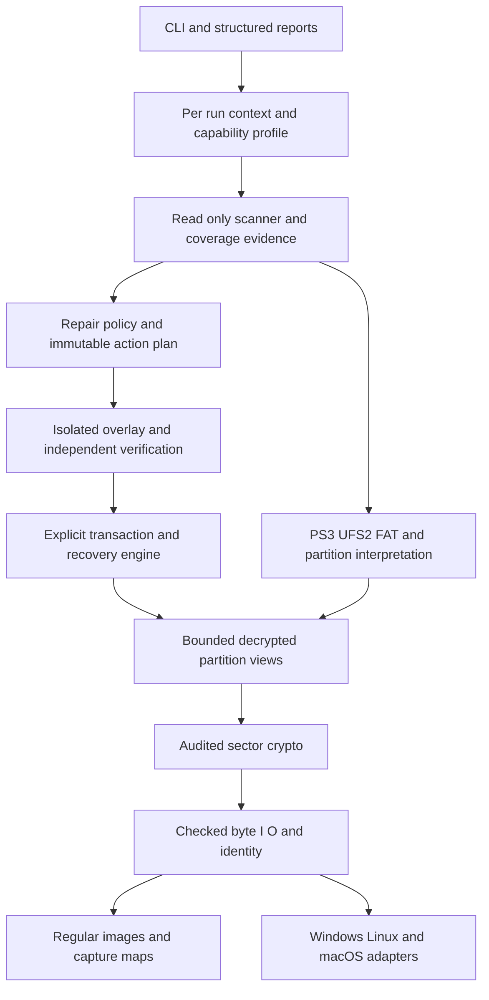

# Cross Platform C++ PS3 Repair CLI Roadmap

Date: 20 October 2026. Status: source research in progress; PS3-specific native bindings recorded; no development. Target hosts: Windows, Linux and macOS.

A complete PS3 repair CLI is technically feasible with a shared C/C++ core. The candidate foundation is native architecture and components studied in UFS2Xplorer, PS3-specific interpretation and preservation rules from our PS3HDDTool work, and adapted multi-pass checking algorithms from BSD sources. Direct UFS2Xplorer incorporation is unresolved because no source-code licence grant was found at the pinned revision. The unfinished work is PS3-compatible damaged-filesystem interpretation, explicit repair policy, recoverable writes and independent qualification.

The user's latest instruction authorizes PS3-specific source research into allocator/normalization selectors, EA payload semantics, feature flags and interrupted inode initialization, plus planning updates. Read-only static examination of existing hash-verified firmware artifacts is included. Eight research tasks remain in progress; 75 tasks remain planned. All 13 qualification gates remain not assessed and unpassed. No development, incorporation, compilation, product tests, physical-drive/private-key access, console actions or publication is authorized. Static source/byte examination and document checks are the evidence earned.

## Read the planning package

| File | Purpose |
| --- | --- |
| [SOURCE-REUSE.md](SOURCE-REUSE.md) | Pinned donors, component decisions, known incompatibilities and provenance obligations |
| [RESEARCH-REGISTER.md](RESEARCH-REGISTER.md) | Sixteen research questions with closure evidence and dependencies |
| [VALIDATION-GATES.md](VALIDATION-GATES.md) | Thirteen gates, corruption and failure matrices, platform and console acceptance |
| [TASKS.json](TASKS.json) | 83 stable task IDs with dependencies, acceptance criteria and future deliverables |
| [SOURCE-SNAPSHOT.json](SOURCE-SNAPSHOT.json) | Exact external revisions and hashes of selected local source/context files |
| [CONTINUATION.txt](CONTINUATION.txt) | Starting order, scope restrictions and a pasteable planning continuation |
| [PLAN-VALIDATION.json](PLAN-VALIDATION.json) | Readback, reference, graph and preservation checks for these documents |
| [INITIAL-RESEARCH.md](INITIAL-RESEARCH.md) | Verified initial findings, incorporation decisions, remaining gaps and next research order |
| [FORMAT-FINDINGS.md](FORMAT-FINDINGS.md) | Pinned disk, crypto and UFS field/invariant evidence; unresolved profile questions |
| [LICENSING-REUSE.md](LICENSING-REUSE.md) | Sampled file-level licence/provenance inventory and dependency boundaries |
| [RESEARCH-SOURCES.json](RESEARCH-SOURCES.json) | Additional research pins and selected byte hashes; does not replace the original baseline |
| [FORMAT-RESEARCH-2.md](FORMAT-RESEARCH-2.md) | Native accounting relationship, EA record framing, flag-state rules and damaged-prefix coverage policy |
| [FORMAT-RESEARCH-SOURCES.json](FORMAT-RESEARCH-SOURCES.json) | Follow-up source hashes, notices and saved native-listing provenance |
| [PS3-NATIVE-RESEARCH.md](PS3-NATIVE-RESEARCH.md) | PS3 selector/global bindings, EA operations, native flags and initialization ordering |
| [PS3-NATIVE-SOURCES.json](PS3-NATIVE-SOURCES.json) | Verified firmware identities, mapped range hashes and native evidence locators |

This package is additive under research/PS3-REPAIR-CLI. It does not replace or update the active firmware authority in C:/Projects/PS3Firmware/plan, shared PS3HDDTool sources, existing candidates or hardware protocols.

## Completion contract

Complete means that every advertised operation has accepted evidence for its exact supported tuple:

core revision x host OS and version x CPU architecture x image or device backend x crypto layer and sector origin x partition and filesystem dialect x geometry and accounting convention x operation x capacity class.

A supported image reader is not automatically a physical writer. A Linux result does not qualify Windows or macOS. Native console checking, ordinary I/O, recovery/update behavior and original-content preservation remain separate evidence.

The required suite includes:

- Device and image inspection, key/profile admission, PS3 disklabel and nested-region mapping.
- Resumable encrypted acquisition with unreadable-range maps and bounded retries.
- Complete bounded UFS2 checking for supported PS3 profiles.
- Reviewable repair plans, isolated overlays, checked application, restart recovery and verified rollback.
- Recovery/export of files and disconnected objects with explicit confidence and loss accounting.
- Backup, archive verification, restoration and file-level migration.
- FAT12, FAT16 and FAT32 checking/repair, nested VFLASH inspection and separately qualified critical-region repair.
- Bounded partition-table reconstruction and repair only where independent evidence determines the intended map.
- Structured reports, exit outcomes, progress/cancellation, private-key handling, support documentation and reproducible packages.

Original bytes cannot always be inferred from damaged metadata. A correct result may be export-only or refusal. Logical consistency does not prove that readable payloads equal their original contents; previous hashes or independent content evidence are required for that claim.

Application-level XMB database validation is optional CLI-075. Greater-than-2-TiB console support is optional CLI-018/056. Neither extension silently enters the ordinary supported profile. Firmware patching, arbitrary formatting/resizing, TRIM and physical hardware repair require separate scope decisions.

## Existing foundation and remaining research

Our published PS3HDDTool migration work verifies one Windows same-console CBC migration involving 331,755 nodes and 830,359,369,613 logical bytes. Its strict inventory and independent fixtures are valuable specifications. This result does not qualify a C++ translation, arbitrary filesystem repair or every console profile.

UFS2Xplorer supplies a Qt-independent C++20 structure, OpenSSL crypto, disk views, accounting routines and generated regression cases to study. Its existing checker/repair paths require replacement or substantial adaptation because incomplete reads/traversal can be hidden, ownership is incomplete, orphan handling is destructive, summary changes use existing totals and durable flush is not implemented through all backends. Treat its source as reference-only until permissions and derivation are resolved.

NetBSD contributes inode/block, directory, connectivity, reference and allocation-reconstruction algorithms. Current NetBSD can clear external-attribute fields on ordinary UFS2, while the older comparison branch omits their ownership accounting. Its format conversions, generic flag clearing and 512-byte inode-accounting assumptions cannot be adopted unchanged.

The initial research corroborates the real PS3 disklabel layout through an additional upstream parser with shared source lineage and resolves cg_initediblk as an exclusive count of initialized inode slots. It also adds a pinned FreeBSD 8 comparator with ordinary-UFS2 EA extent accounting, although its EA content scanner is a stub. Our migration core has fixed 512-byte inode accounting and explicit supplied partition/profile inputs; its earned migration result does not validate generic partition discovery or every 512e accounting variant. See the new findings documents for exact locators and open questions.

FORMAT-RESEARCH-2.md records fsbtodb-derived checking, comparator EA framing, separate legacy/new flags and damaged-prefix coverage rules. Unknown records cannot become free through donor defaults, probable-end heuristics or clamping. Its then-open native selector and payload bindings are advanced by the latest packet below; complete format/repair gates remain open.

The latest native packet advances those bindings: the allocator globals have initialized 9/512 and a real 12/4096 setter controlled by an internal-HDD IDENTIFY predicate; P13 normalization uses the same field predicate and collapses query failure into false. P4 VOP/function descriptors bind seven-byte big-endian EA records and namespace access predicates, while actual value schemas remain opaque. Native flag branches connect bit 0x02 to the initialization dependency hook. Kernel lazy-init mutation/submission order is now traced, but durable ordering and complete dependency/error callbacks remain open. PS3-NATIVE-RESEARCH.md is the current source-level disposition.

The current firmware-context handoff is analysis/dev006/metadata-budget-proof-v3/CONTINUATION.txt, refreshed after concurrent changes to the four separate status roots. It reports offline formatter/source-proof advances; installed RDI2 and broader native resource/profile/stability boundaries remain unchanged. Current context hashes are recorded separately from the immutable research baselines. That task supplies failure/resource questions and was not continued here; its newer ELF-only outputs do not replace the pinned P4/P13 research inputs.

## Architecture

Use a shared C++ core with audited C algorithms where appropriate. C++20 is the initial proposal because the native donor already uses it; CLI-006 settles the supported standard, compilers and dependency policy before later development. C-compatible wrappers can isolate adapted C routines without exposing operating-system types throughout the core.

Key architectural requirements:

1. Scanning uses an OS read-only handle and a storage interface that cannot write.
2. Every read has an exact success/partial/error outcome. Unknown bytes remain unknown.
3. All address multiplication/addition, lengths, counts and conversions are checked before allocation or access.
4. One logical-offset iterator accounts for data, holes, indirect metadata, attributes and fragment tails.
5. Findings contain coverage and dependency information. Global clean, reclaim and map-rebuild decisions require complete relevant ownership.
6. Adapted fsck routines mutate an isolated view. Target writes occur only through the transaction engine.
7. No destructor, error callback or cache eviction may implicitly commit target changes.
8. All overwritten encrypted/physical write units have durable before-images and verified plan preconditions.
9. Per-run context replaces shared mutable globals and process exits. Cancellation preserves evidence and a defined terminal state.
10. Reports preserve raw names safely and omit private key material and unrequested user payload.
11. Export/restore confines untrusted names, links and archive paths to the selected destination. Capture maps and archives have independent integrity and interrupted-publication checks.

## Dependencies and toolchain

| Dependency | Role and decision |
| --- | --- |
| MSVC, Clang and GCC | Proposed host compiler families. Pin supported versions and prove every advertised architecture. |
| CMake | Shared build and packaging configuration; version decision in CLI-006. |
| OpenSSL | Candidate audited crypto provider. Select a supported release, distribution strategy and notice set at implementation intake. |
| CTest and Catch2 or equivalent | Candidate test harness; final choice must support independent oracles and fault injection. |
| Sanitizers and fuzz engines | Later bounded-input verification on applicable targets; unsupported host combinations need alternative evidence. |
| Independent fixture/oracle tooling | Separate declarative construction and mathematical accounting, potentially a second language. |
| Disposable media and console fixtures | Future physical/native evidence only, under separately specified user authority. |

The production CLI should not depend on .NET, Qt, a BSD VM or a mounted kernel UFS driver. Those may remain external comparison tools. Dependency locking, file-level notices, binary inventories and journal/report compatibility are part of the release contract.

## Milestones and dependency order

| Milestone | Tasks | Result and exit gate |
| --- | --- | --- |
| M0 Scope and reuse contracts | CLI-001-006 | G00: supported claims, provenance and boundaries decided |
| M1 PS3 format specification | CLI-007 through CLI-017; CLI-019/020 | G01/G02: exact profiles, repair rules and independent corpus design |
| M2 Native shared core and image access | CLI-021-033, CLI-038, CLI-049, CLI-067 | G03: checked image I/O, crypto and decoding on each target build |
| M3 Complete read-only UFS2 checker | CLI-034-040, CLI-076 | G04: ownership, graph, counters, coverage and resources independently checked |
| M4 Reviewable repair plans | CLI-041-044, CLI-077 | G05: deterministic actions and isolated overlay results |
| M5 Recoverable image repair | CLI-045-050 | G06: before-images, checked commit, repeated/interrupted recovery and verification |
| M6 Device and console qualification | CLI-028-030, CLI-051-055, CLI-073 | G07/G08: per-host raw capabilities and per-profile native acceptance |
| M7 Full companion suite | CLI-016-017, CLI-057-065, CLI-077-078, CLI-081 | G09/G10/G11: FAT, VFLASH, partitions, acquisition, recovery, backup and migration |
| M8 Complete suite release | CLI-066-074, CLI-079-080, CLI-082-083 | G12: exact supported operation tuples accepted and release reviewed |

The JSON register is authoritative for individual dependencies; the ranges above are human summaries and can overlap. Work may proceed in parallel after its actual prerequisites close.

Critical path: requirements/provenance -> disk/crypto/units -> UFS2 dialect -> complete ownership and directory evidence -> repair policy/overlay -> transaction recovery -> physical adapters -> exact console profiles -> full-suite release.

Independent branches include FAT/VFLASH research after disk/crypto mapping; adapter contract work after units/identity decisions; fixture/oracle construction after format rules; and acquisition/report/resource design alongside the scanner. FAT/VFLASH implementation may advance alongside UFS2 but cannot borrow its acceptance.

CLI-018/056 stay a separate high-capacity branch. CLI-075 stays an optional application-layer branch. An interim image-only or UFS2-only release must name that limited scope and cannot close the complete-suite milestone.

## Support matrix

Every cell begins unqualified for the future C/C++ suite. Existing donor evidence is a reference, not a passed cell.

| Axis | Planned targets and restrictions |
| --- | --- |
| Hosts | Windows, Linux, macOS; supported versions decided by CLI-003/006 |
| Architectures | x86-64 and ARM64 candidates; qualify each advertised build/backend separately |
| Inputs | Raw encrypted images, explicit plaintext partition views, supported offline physical devices |
| Keys | Supplied root key or exact derived key form for the selected layer; no automatic private key export |
| Crypto | NAND CBC; actual fat NOR profile; Slim XTS; nested VFLASH layers as observed and validated |
| Sector conventions | 512n baseline and observed 512e accounting variants separately; native 4Kn remains unsupported unless explicitly researched and qualified |
| UFS2 features | Raw names, links, holes, direct through triple-indirect addressing, inline/block symlinks, EAs, partial groups and admitted dirty states |
| FAT | FAT12/16/32 profiles with separate map, repair and recovery evidence |
| Capacity | Exact supported sector counts and boundary cases; decimal 2 TB does not imply support beyond 2 TiB |
| Operations | Read, scan, export, plan, image repair, physical repair, resume, rollback, capture, backup, restore and migrate separately |
| Console acceptance | Exact model/firmware/layout/drive tuple; no universal PS3 support inferred |

Unknown flags, snapshots, pending frees, mixed accounting and uncertain initialization require a declared support or refusal policy. An export capability may be allowed where full repair remains refused, provided its output manifest preserves uncertainty.

## Evidence and release rules

The validation document distinguishes source review, compilation, generated tests, real-image checks, physical transport, console behavior and user acceptance. Gate closure must bind exact source/package versions and the relevant support tuple. A second clean scan and an empty second repair plan are necessary checks, but are insufficient without independent accounting and sector-diff evidence.

A release ledger must make partial support visible. If a mandatory companion track has no accepted profile, the suite remains partial. Optional greater-capacity and application-layer work do not block the ordinary complete scope unless advertised.

No calendar estimate is adopted. The largest uncertainty is semantic compatibility and recoverable physical writes, not generating a CLI or compiling the core. Estimate effort only after R01-R05 and the repair-action catalogue are closed.

## Risks and next planning work

The highest risks are false completeness after skipped metadata, incorrect free-map reconstruction, destructive orphan decisions, unit/profile mismatch, missing EA/indirect ownership, and uncertain persistence after interrupted writes. Address these through the explicit research and validation entries, not additional boot-only or unchanged capacity-fill loops.

Next research order: finish CLI-001/003 support contracts and CLI-002 incorporation decisions; then trace complete shared-global lifecycle and buffer/dependency completion/error paths, later inode/directory publication, actual EA names/value consumers and remaining flag/replica semantics. Bind these to named PS3 profiles and independent cases. Use the saved native facts and prior proposed coverage tables; do not repeat resolved selector/framing work or import donor repair defaults. No complete research task or technical gate is closed.

No current drive movement, firmware update, repair run, diagnostic launch, key access or source modification is requested. See CONTINUATION.txt before any later session.

